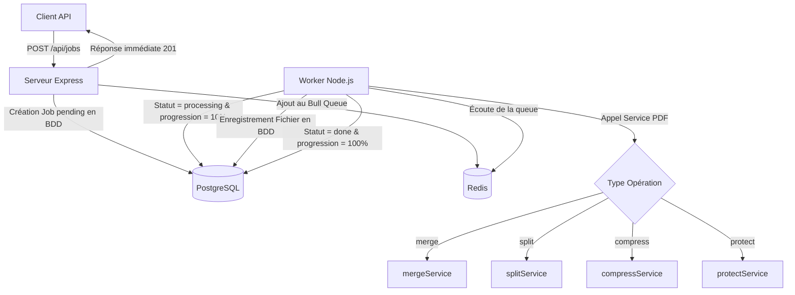

# Intégration du Worker & Files d'attente (Bull Queue)

**Semaine :** S3
**Statut :** ✅ Services réels connectés (Fin de la simulation S2)
**Fichier de configuration :** [queue.js](file:///c:/Users/USER/Desktop/docmaster-app/backend/src/jobs/queue.js)
**Worker :** [pdfWorker.js](file:///c:/Users/USER/Desktop/docmaster-app/backend/src/jobs/pdfWorker.js)

## Vue d'ensemble

Le système de traitement asynchrone utilise **Bull** (basé sur **Redis**) pour gérer la file d'attente des tâches lourdes. En Semaine 3, la simulation du traitement (délais artificiels de la S2) a été remplacée par les appels réels aux services de manipulation PDF (`merge`, `split`, `rotate`, `compress`, `protect`, `watermark`).

## Flux de traitement en Semaine 3



## Intégrations majeures (Semaine 3)

### 1. Remplacement de la simulation
Le switch/case du worker appelle désormais les vrais fichiers de service :
```javascript
switch (type_operation) {
  case 'merge':
    resultat = await mergeService(cheminsFichiers);
    break;
  case 'split':
    resultat = await splitService(cheminsFichiers[0], options.selection, options.mode);
    break;
  case 'compress':
    resultat = await compressService(cheminsFichiers[0], options.niveau);
    break;
  // ...
}
```

### 2. Gestion dynamique des formats de sortie (MIME-Type & Extensions)
Suite aux améliorations apportées au module `split` (mode `separate` produisant une archive `.zip` au lieu d'un `.pdf`), le worker adapte dynamiquement l'enregistrement du fichier résultat en base de données :
- **MIME-Type** : Récupéré depuis le résultat du service (`resultat.typeMime` ou `'application/pdf'` par défaut).
- **Nom original & Extension** : L'extension est déduite du MIME-Type (`pdf` ou `zip`), permettant de nommer proprement le livrable (`resultat_split.pdf` ou `resultat_split.zip`).

## Monitoring & Résilience

- **Attempts (Tentatives)** : Configuré à `3` tentatives automatiques en cas d'échec du job.
- **Backoff (Délai d'attente)** : Délai fixe de `5000ms` (5 secondes) entre chaque tentative.
- **Nettoyage automatique** :
  - Les jobs réussis sont immédiatement nettoyés de Redis (`removeOnComplete: true`).
  - Les 100 derniers jobs échoués sont conservés pour analyse et débug (`removeOnFail: 100`).
